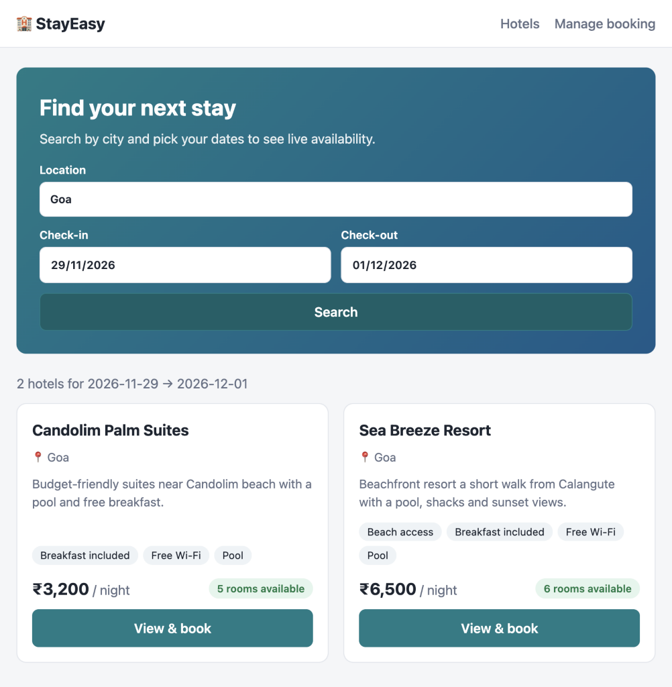
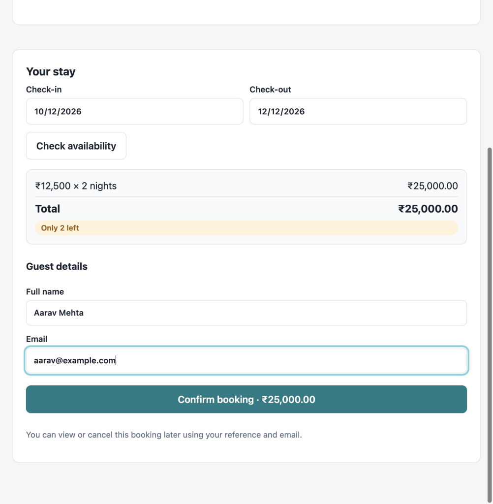
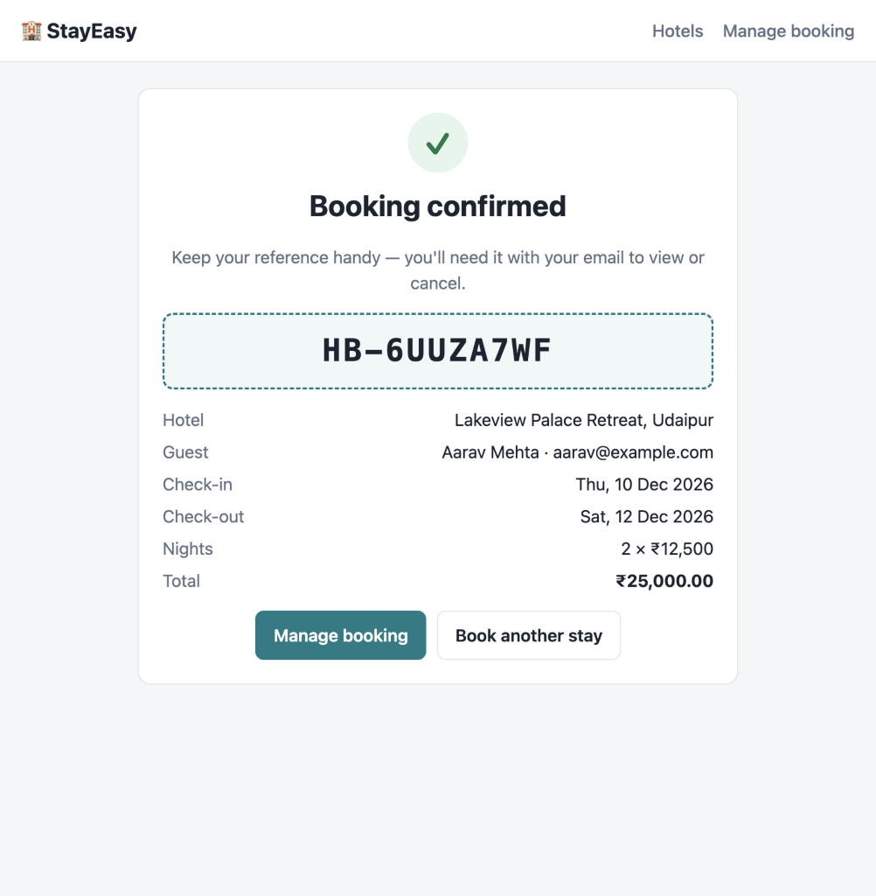
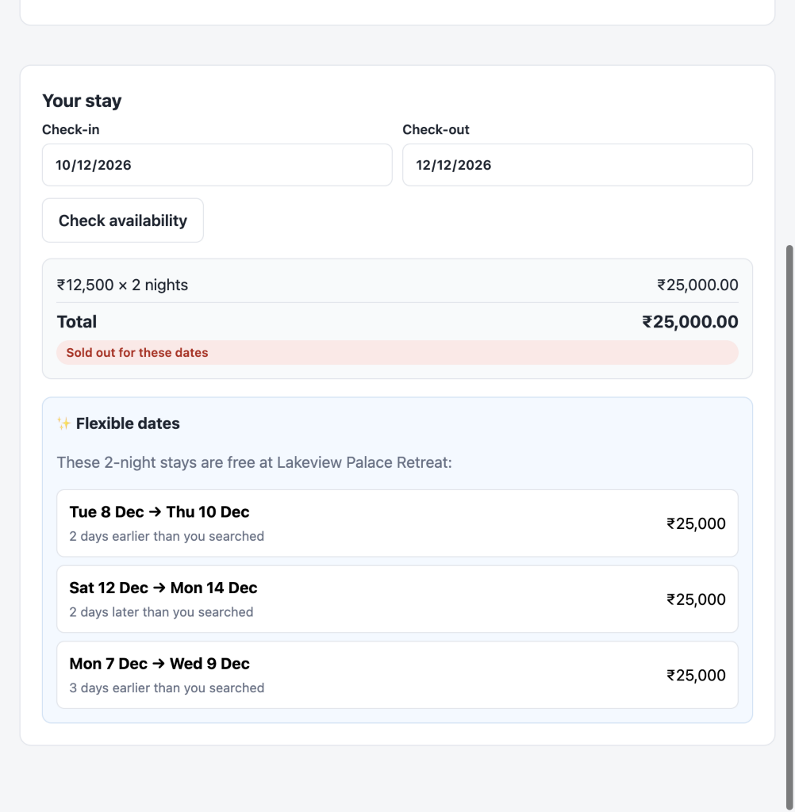
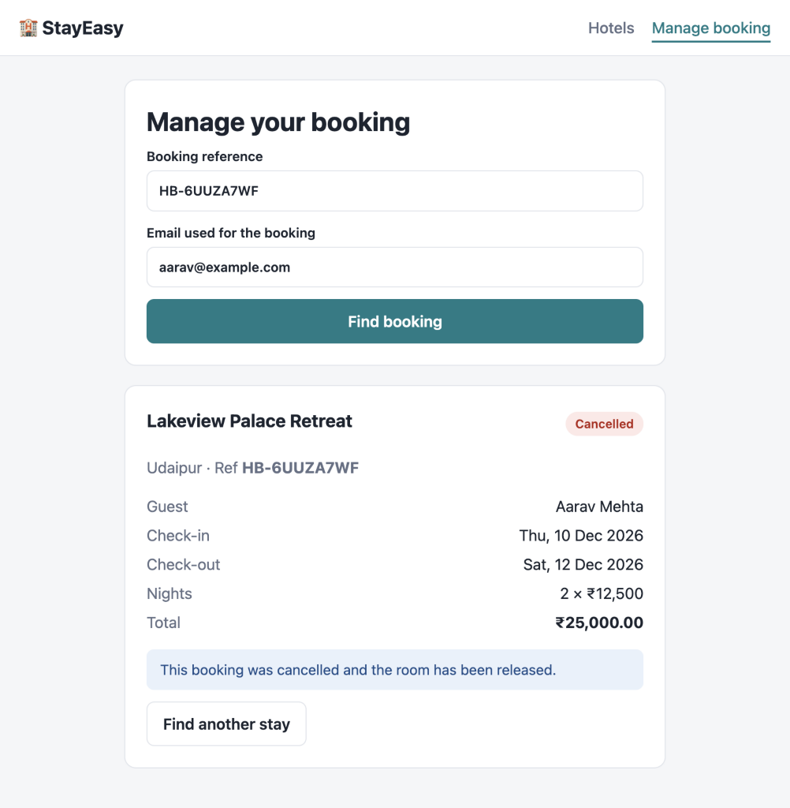

# StayEasy – Hotel Booking Portal

Spring Boot + Angular + MySQL hotel booking portal built for the Full-Stack interview assignment.
Browse hotels, search by location and dates, see a backend-calculated price, book a room, then look up
and cancel the booking with its reference + email.

**Surprise feature: Flexible-date suggestions** — when a hotel is sold out for your dates, the app offers the
nearest same-length stays (±7 days) that still have a room, with prices, one click to switch. See [DESIGN.md](DESIGN.md).

## Prerequisites

| Tool | Version |
|---|---|
| JDK | 17+ |
| Maven | 3.9+ |
| Node.js / npm | 20+ (Angular 18) |
| MySQL | 8.0.16+ (CHECK constraints are enforced from 8.0.16) |
| Docker (optional) | only if you want MySQL via `docker compose` |

## Run locally

### 1. Database

Credentials are **not** in the repo. Copy the template and pick your own passwords:

```bash
cp .env.example .env        # then edit the passwords
```

**Option A – Docker (easiest):**
```bash
docker compose up -d        # starts MySQL 8 with the DB and user from .env
```

**Option B – existing MySQL:**
```sql
CREATE DATABASE hotel_booking CHARACTER SET utf8mb4;
CREATE USER 'hotel_app'@'%' IDENTIFIED BY 'your-password';
GRANT ALL PRIVILEGES ON hotel_booking.* TO 'hotel_app'@'%';
```

No manual SQL import is needed: **Flyway runs on startup** and applies
`backend/src/main/resources/db/migration/V1__schema.sql` (tables + constraints) and
`V2__sample_data.sql` (7 hotels).

### 2. Backend (http://localhost:8080)

```bash
cd backend
export DB_USERNAME=hotel_app
export DB_PASSWORD=your-password          # same as in .env
mvn spring-boot:run
```
(Windows PowerShell: `$env:DB_USERNAME="hotel_app"; $env:DB_PASSWORD="your-password"`.)

### 3. Frontend (http://localhost:4200)

```bash
cd frontend
npm install
npm start          # ng serve; /api calls are proxied to localhost:8080 via proxy.conf.json
```

Open http://localhost:4200.

### Tests

```bash
cd backend && mvn test
```
Covers date validation, price calculation, availability across overlapping stays, booking the last room,
cancellation releasing availability, double-cancel, and booking lookup. They use Mockito, so no database is needed.

## Try the main flow

1. Search "Goa" with check-in/check-out dates → see availability badges.
2. Open **Lakeview Palace Retreat** (Udaipur, only 2 rooms) → enter name + email → **Confirm booking** (note the reference).
3. Repeat with another email until the hotel shows **Sold out** → the **Flexible dates** panel suggests nearby free stays.
4. Go to **Manage booking**, enter reference + email, and cancel → availability is released.

## Screenshots

Full walkthrough screenshots are in [`docs/screenshots/`](docs/screenshots/README.md):

| Search & Availability | Hotel Quote | Confirmation |
|---|---|---|
|  |  |  |

| Flexible Dates (Surprise Feature) | Manage & Cancel Booking |
|---|---|
|  |  |

## API summary

| Method | Path | Purpose |
|---|---|---|
| GET | `/api/hotels?location=&checkIn=&checkOut=` | List/search hotels (+ availability if dates given) |
| GET | `/api/hotels/{id}?checkIn=&checkOut=` | Hotel details |
| GET | `/api/hotels/{id}/quote?checkIn=&checkOut=` | Nights, total and rooms left (price computed on backend) |
| GET | `/api/hotels/{id}/alternatives?checkIn=&checkOut=` | Surprise feature: nearby free stays |
| POST | `/api/bookings` | Create booking → `201` with reference |
| GET | `/api/bookings/{reference}?email=` | Retrieve a booking |
| POST | `/api/bookings/{reference}/cancel` | Cancel (body: `{ "email": "..." }`) |

All errors share one shape: `{ timestamp, status, code, message, path, fieldErrors? }`.

## Assumptions

- **Overlapping stays:** a stay is the half-open range `[check-in, check-out)`. It reserves one room on every
  *night* it covers, not on the check-out day, so a guest checking out on the 10th and another checking in on
  the 10th never conflict. A new booking is accepted only if *every* night still has a free room.
- Each hotel has one room category; `total_rooms` is its capacity. One booking = one room.
- Maximum stay is 30 nights. "Today" uses the server's time zone.
- Prices are in INR; the booking stores a snapshot of the nightly price so later price changes don't alter it.
- Cancellation is allowed until the check-in date has passed (check-in day itself is still cancellable).
- Email is lower-cased for matching; a wrong email and a wrong reference produce the same "not found" message.
- No authentication/payment/admin/deployment (out of scope per the brief).

## Time spent, status and AI disclosure

> **TODO before submitting — replace with your own honest numbers.**

- **Approximate time spent:** _X hours_
- **Unfinished / known gaps:** no frontend unit tests; Maven wrapper not generated;
  no concurrency integration test against a real MySQL (see DESIGN.md → Limitations).
- **AI assistance:** the initial scaffold of the backend, frontend and docs was generated with Claude (Anthropic).
  _Describe what you reviewed, changed and tested yourself._ You should be able to explain every part in the interview.
