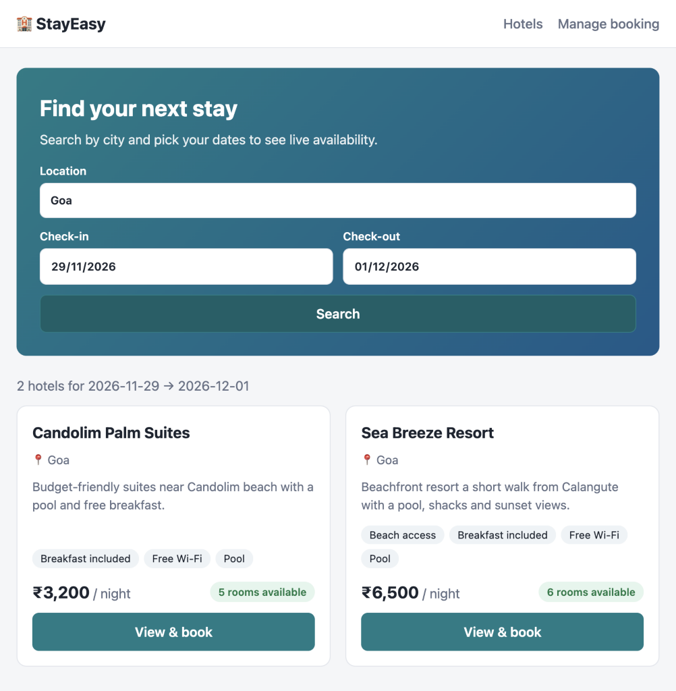
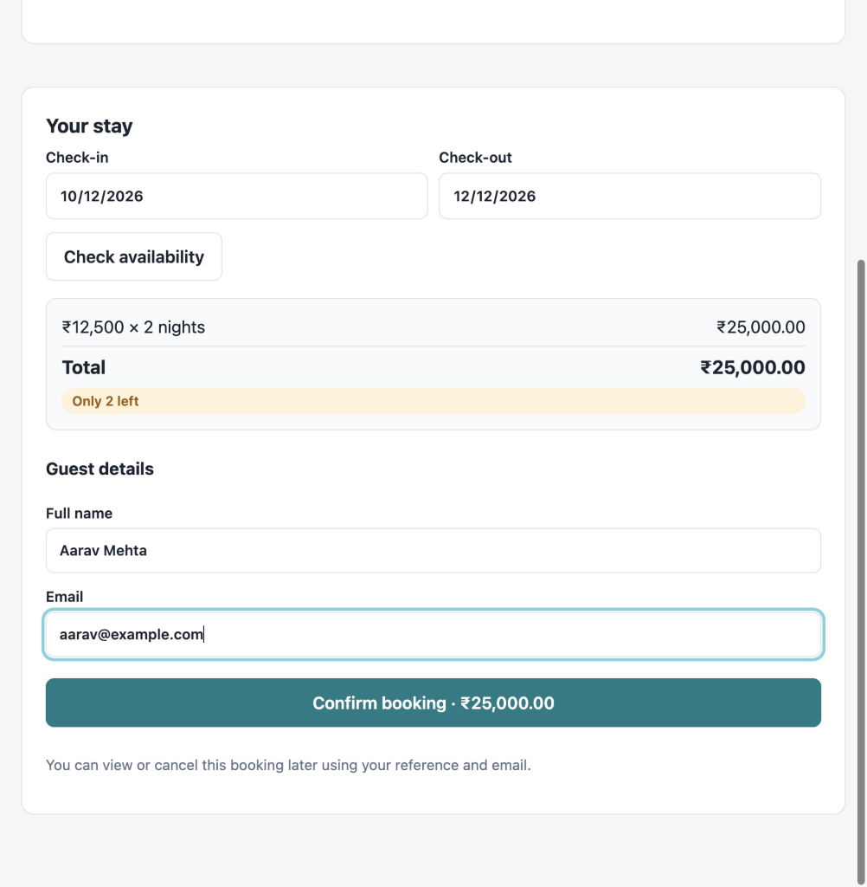
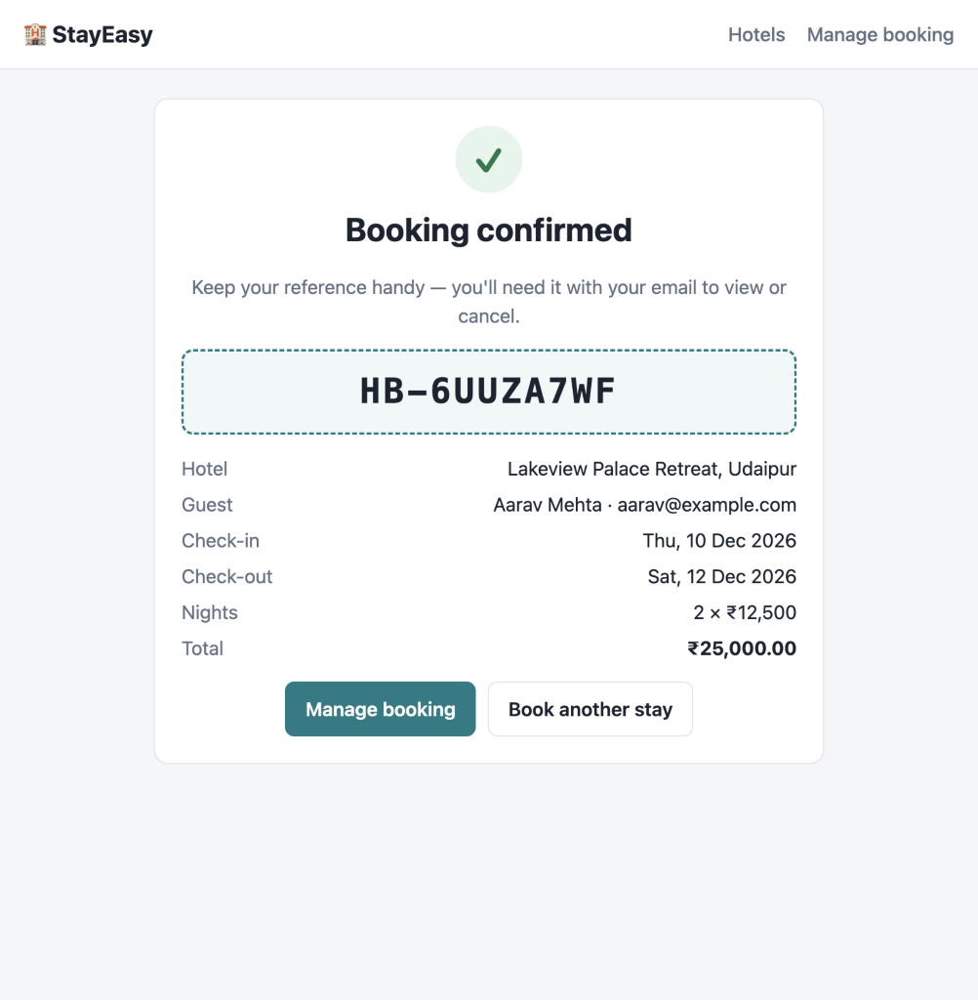
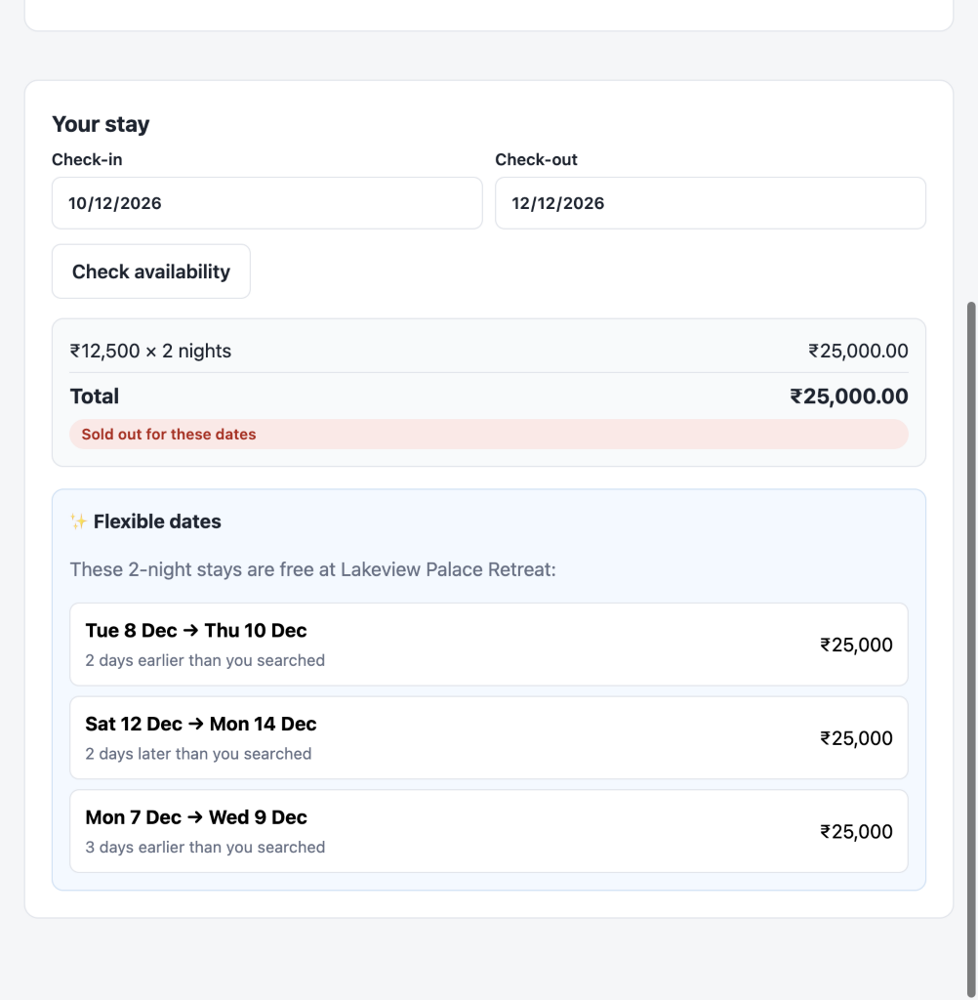
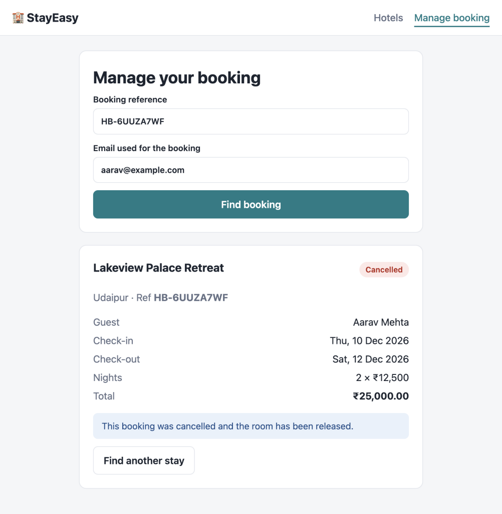

# StayEasy Screenshots

Main booking flow and surprise feature captured from the running local application (`http://localhost:4200` + Spring Boot `:8080` + MySQL 8):

1. **Search & availability badges** — filtering by location (`Goa`) and stay dates (`2026-11-29` → `2026-12-01`)
   

2. **Hotel details & backend-calculated quote** — `Lakeview Palace Retreat` (Udaipur) showing nights, total (`₹25,000.00`), and remaining rooms (`Only 2 left`)
   

3. **Booking confirmation** — unique reference (`HB-...`) and stay summary after `POST /api/bookings`
   

4. **Surprise feature: Flexible-date suggestions** — when all rooms are booked, nearest available same-length stays (±7 days) are offered with prices and one-click switching
   

5. **Manage & cancel booking** — lookup by reference + email and cancellation releasing the room back to availability
   
